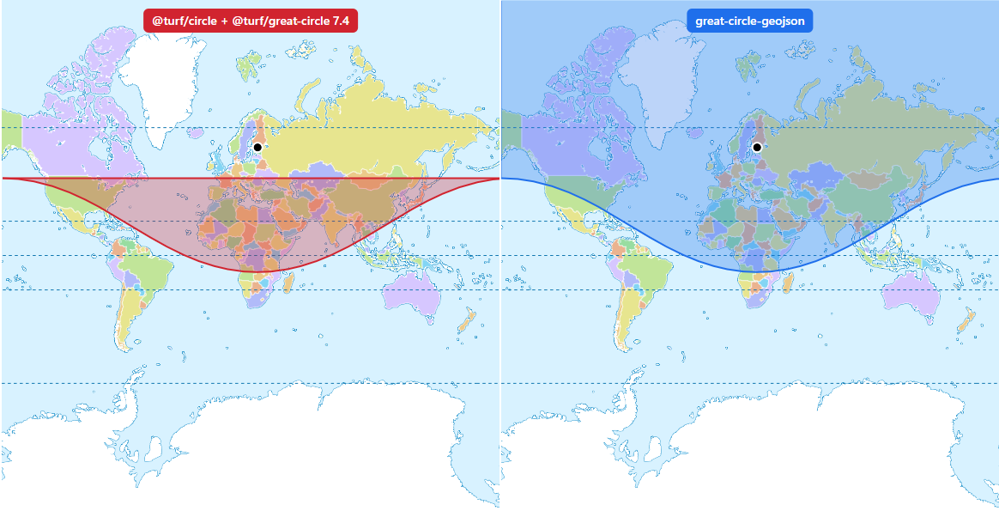

# great-circle-geojson

Range circles and great-circle routes as GeoJSON that render correctly over the poles and across the antimeridian.



*An 8,000 km range from Helsinki: `@turf/circle` (left) and `great-circle-geojson` (right). [Live demo](https://samipuro.github.io/great-circle-geojson/demo/)*

No dependencies, TypeScript types included. Extracted from [AirwaySim](https://www.airwaysim.com), where it draws aircraft range maps.

## Usage

```sh
npm install great-circle-geojson
```

```js
import { rangeCircle, rangeLine, greatCircle } from 'great-circle-geojson';

const helsinki = [24.96, 60.32];

const area = rangeCircle(helsinki, 8000e3);              // Polygon of the area within 8,000 km
const outline = rangeLine(helsinki, 8000e3);             // LineString of its boundary
const route = greatCircle(helsinki, [139.78, 35.55]);    // LineString of the route to Tokyo
```

| Function | Returns |
|---|---|
| `rangeCircle(center, radiusMeters, options?)` | `Polygon` of the area. Over one pole it closes along the pole; over both poles it is the world with the unreachable area as a hole. |
| `rangeLine(center, radiusMeters, options?)` | `LineString` of the boundary, without the pole closing edges. |
| `enclosesPole(center, radiusMeters, options?)` | `true` when the circle reaches over the nearer pole. |
| `greatCircle(start, end, options?)` | `LineString` of the route, in one piece across the antimeridian. |

Positions are `[longitude, latitude]`, distances in meters on a sphere. Options: `steps` (segments), `maxLatitude` (default `85` for Web Mercator maps, use `90` otherwise) and `earthRadius`.

Longitudes may go beyond ±180 to keep shapes in one piece, which MapLibre GL JS draws correctly. Split the geometries yourself if your tools need the RFC 7946 antimeridian cut.

## Contributing

Issues and pull requests are welcome.

## License

MIT, Sami Puro